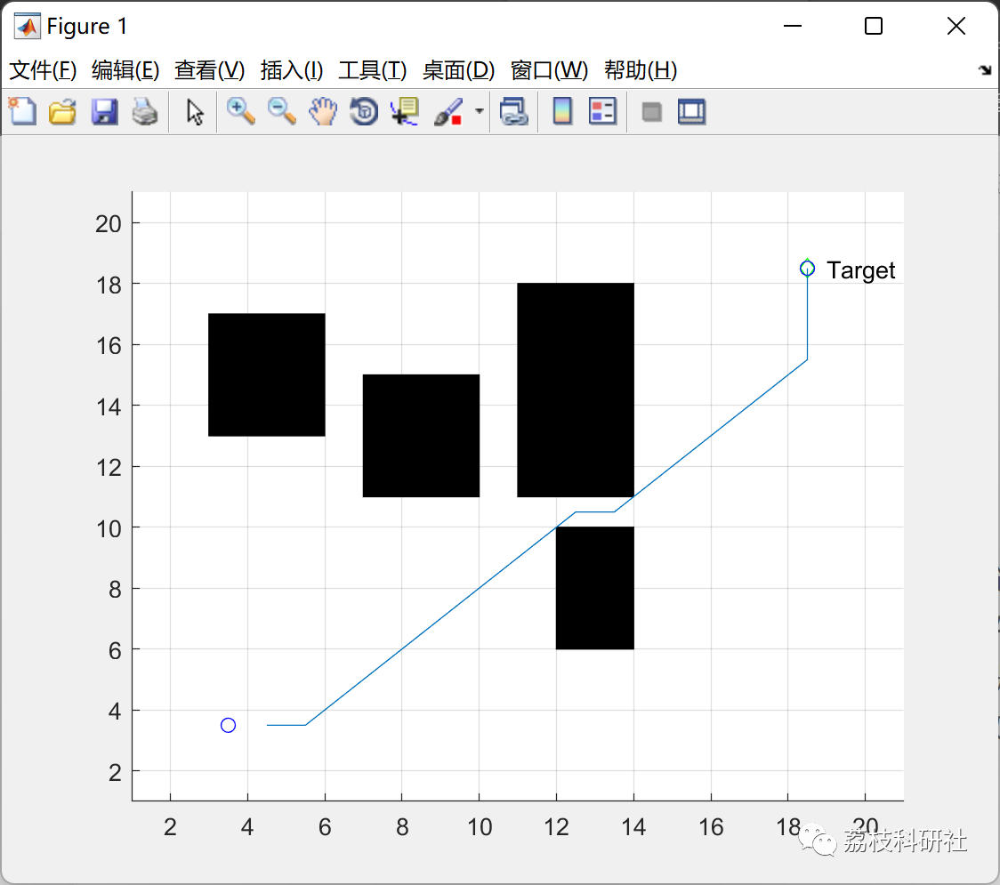

# Path Planning for Mobile Robots Based on D* Algorithm (Matlab Code Implementation)

💥💥💥💞💞💞💞 Welcome to this blog❤️❤️❤️💥💥💥
🏆 Bloggers' Advantage: 🌞🌞🌞 The content of the blog strives to be rigorous in thought and clear in logic, for the convenience of readers.
⛳️ Mantra: The journey of a hundred miles is half done in the last ninety.
Litchi Research Society
Code Collection: Power System, Intelligent Algorithms and Applications, Neural Network Prediction, Path Planning, Optimized Scheduling, Workshop Scheduling, Image Processing, Signal Processing...
🎁Column Directory Link:
🌈🌈🌈🌟🌟🌟🛫🛫🛫🛫🛫🛫🛫🛫🛫🛫🛫🛫🛫🛫🛫🛫🛫🛫🛫🛫🛫🛫🛫🛫🛫🛫🛫🛫🛫🛫🛫🛫🛫🛫🛫🛫🛫🛫🛫🛫🛫🛫🛫🛫🛫🛫🛫🛫🛫🛫🛫🛫🛫🛫🛫🛫🛫🛫🛫🛫🛫🛫🛫🛫🛫🛫🛫🛫🛫🛫🛫🛫🛫🛫🛫🛫🛫🛫🛫🛫🛫🛫🛫🛫🛫🛫🛫🛫🛫🛫🛫🛫🛫🛫🛫🛫🛫🛫🛫🛫🛫🛫🛫🛫🛫🛫🛫🛫🛫🛫🛫🛫🛫🛫🛫🛫🛫🛫🛫🛫🛫🛫🛫🛫🛫🛫🛫🛫🛫🛫🛫🛫🛫🛫🛫🛫🛫🛫🛫🛫🛫🛫🛫🛫🛫🛫🛫🛫🛫🛫🛫🛫🛫🛫🛫🛫🛫🛫🛫🛫🛫🛫🛫🛫🛫🛫🛫🛫🛫🛫🛫🛫🛫🛫🛫🛫🛫🛫🛫🛫🛫🛫🛫🛫🛫🛫🛫🛫🛫🛫🛫🛫🛫🛫🛫🛫🛫🛫🛫🛫🛫🛫🛫🛫🛫🛫🛫🛫🛫🛫🛫🛫🛫🛫🛫🛫🛫🛫🛫🛫🛫🛫🛫🛫🛫🛫🛫🛫🛫🛫🛫🛫🛫🛫🛫🛫🛫🛫🛫🛫🛫🛫🛫🛫🛫🛫🛫🛫🛫🛫🛫🛫🛫🛫🛫🛫
💥1 Overview
Intelligent navigation is a key technology for mobile robots, playing an important role in the research of their applications. Navigation primarily consists of three parts: constructing a map, positioning, and path planning. Map construction refers to the process by which a mobile robot builds its working environment model based on its sensors' perception of the surroundings; positioning involves determining the specific location of the mobile robot within its working environment, that is, the coordinates and posture of the robot in the virtual map; path planning involves finding a safe, collision-free optimized path from a specified starting point to a specified destination in complex environments, under certain constraints such as short walking paths, low path costs, and short time requirements. In recent decades, various effective solutions have emerged in addressing these issues, including Synchronous Building and Mapping (SLAM), Monte Carlo Localization Algorithms, and Dynamic Window Algorithms (DWA) among others.
The DWA algorithm is a method for robots to update their local information based on sensor data, control the robot's speed within an effective "window" for real-time path planning.
The D* algorithm is proposed based on the A* algorithm, addressing scenarios where there is a lack of prior knowledge about the environment or dynamic path planning solutions.
📚2 A* Algorithm
The A* algorithm is a typical heuristic search algorithm in artificial intelligence. It guides the search towards the most promising direction by selecting an appropriate evaluation function to achieve the optimal solution. The A* algorithm addresses the issue of extensive invalid search paths often encountered in previous path planning problems, enhancing the goal-directedness of the search and improving the efficiency of the algorithm through the use of a heuristic function. The core design of the A* algorithm lies in its evaluation function.
👨‍💻3 Running Results
🎉4 References
[1] Zhang Ximou, Xiao Benxian. Improved D~* Algorithm for Path Planning of Mobile Robots [J]. Sensors and Microsystems, 2018, 37(12):52-54+58. DOI:10.13873/J.1000-9787(2018)12-0052-03.
[1] Zhang He, Hu Yueli, Wang Quan, Yan Ming. Path Planning Based on Improved D* Algorithm for Mobile Robots [J]. Industrial Control Computer, 2016, 29(11):73-7477.
👨‍💻5 Matlab Code Implementation
Click the article's lower left corner to read more.

## Images

<!-- PAYMENT_BLOCK -->

## Get this dataset

- Payment link (Stripe): [Buy now](https://buy.stripe.com/3cs8yP7sY87d0vu9AB)
- Payment QR code: 

<!-- /PAYMENT_BLOCK -->
